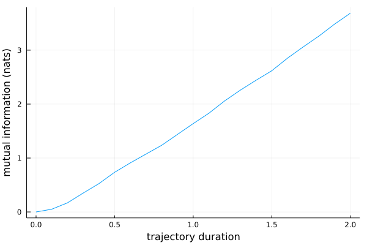

# PathWeightSampling.jl

PathWeightSampling.jl is a Julia package to compute information transmission rates using the Path Weight Sampling (PWS) method.

## Background

Biological and artificial systems often transform input signals into outputs. *Information theory* quantifies how much the output reveals about the input using *mutual information*: how much knowing the output reduces uncertainty about the input.

For two random variables ``S`` and ``X``, the mutual information is

```math
\mathrm{I}(S, X) = \sum_{s\in S, x\in X} \mathrm{P}(s, x) \ln\frac{\mathrm{P}(s, x)}{\mathrm{P}(s) \mathrm{P}(x)} \,.
```

For time-dependent signals, however, the mutual information between scalar variables ``S`` and ``X`` at one instant does not measure the *rate* of information transmission. Successive inputs are usually correlated, and so are successive outputs. To account for these correlations, we compute the mutual information between entire input and output trajectories rather than between their values at a single time. Its mathematical form is analogous to the scalar case:

```math
\mathrm{I}(\bm{S}, \bm{X}) = \sum_{\bm{s}\in \bm{S}, \bm{x}\in \bm{X}} \mathrm{P}(\bm{s}, \bm{x}) \ln\frac{\mathrm{P}(\bm{s}, \bm{x})}{\mathrm{P}(\bm{s}) \mathrm{P}(\bm{x})}
```

but now the sum runs over all possible input and output trajectories, denoted by bold symbols, analogous to a path integral.
The information transmission rate ``\mathrm{R}(\bm{S}, \bm{X})`` is then defined as the asymptotic rate at which the trajectory mutual information increases with the duration of the input and output trajectories, i.e.

```math
\mathrm{R}(\bm{S}, \bm{X}) = \lim_{T\rightarrow\infty} \frac{\mathrm{d}\mathrm{I}(\bm{S}_T, \bm{X}_T)}{\mathrm{d}T}
```

where ``\bm{S}_T`` and ``\bm{X}_T`` are trajectory-valued random variables of trajectories with duration ``T``.

PWS computes the mutual information between input and output trajectories for systems described by a master equation.

## Installation

From the Julia REPL, type
```
julia> import Pkg; Pkg.add("PathWeightSampling")
```

Alternatively, you can install this package by starting Julia, typing `]` and then
```
pkg> add PathWeightSampling
```

## Quick Start

Load the package in Julia:
```julia
julia> import PathWeightSampling as PWS
```
Next, define a reaction system. This example uses the included gene-expression model:
```julia
julia> system = PWS.gene_expression_system()
SimpleSystem with 4 reactions
Input variables: S(t)
Output variables: X(t)
Initial condition:
    S(t) = 50
    X(t) = 50
Parameters:
    κ = 50.0
    λ = 1.0
    ρ = 10.0
    μ = 10.0
```
The model has four reactions:

- ∅ → S with rate *κ*
- S → ∅ with rate *λ*
- S → S + X with rate *ρ*
- X → ∅ with rate *μ*

S is the input and X is the output; their parameter values are shown above. To estimate the mutual information between the input and output trajectories, run:

```julia
julia> result = PWS.mutual_information(system, PWS.DirectMCEstimate(256), num_samples=1000)
```

`DirectMCEstimate(256)` selects direct Monte Carlo marginalization with 256 samples. This run takes about a minute on a typical laptop and returns a `DataFrame` with three columns and 1000 rows:

```julia
1000×3 DataFrame
  Row │ TimeConditional  TimeMarginal  MutualInformation                 
      │ Float64          Float64       Vector{Float64}                   
──────┼──────────────────────────────────────────────────────────────────
    1 │     0.000180898     0.0508378  [0.0, -0.67167, 0.388398, -0.343…
  ⋮   │        ⋮              ⋮                        ⋮
 1000 │     0.00020897      0.0694072  [0.0, 0.254173, 0.362607, 0.2584…
                                                         998 rows omitted
```

Each row represents one Monte Carlo sample.

- `TimeConditional` is the CPU time in seconds used to compute the conditional probability P(**x** | **s**).
- `TimeMarginal` is the CPU time in seconds used to compute the marginal probability P(**x**).
- `MutualInformation` contains the mutual information estimates for several trajectory durations. The corresponding durations are:

```julia
julia> system.dtimes
0.0:0.1:2.0
```

Each vector therefore contains estimates for trajectory durations `0.0, 0.1, 0.2, ..., 2.0`.

If Plots.jl is installed, plot the mean estimate with:

```julia
julia> using Plots, Statistics
julia> plot(
           system.dtimes,
           mean(result.MutualInformation),
           legend=false,
           xlabel="trajectory duration",
           ylabel="mutual information (nats)"
       )
```



Averaging the Monte Carlo samples with `mean(result.MutualInformation)` gives the PWS estimate of mutual information.

## Acknowledgments

This work was performed at the research institute [AMOLF](https://amolf.nl).
This project has received funding from the European Research Council (ERC) under the European Union’s Horizon 2020 research and innovation program (grant agreement No. 885065)
and was financially supported by the Dutch Research Council (NWO) through the “Building a Synthetic Cell (BaSyC)” Gravitation grant (024.003.019).

[](https://www.nwo.nl)
[](https://amolf.nl)
[](https://www.basyc.nl)