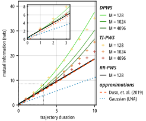
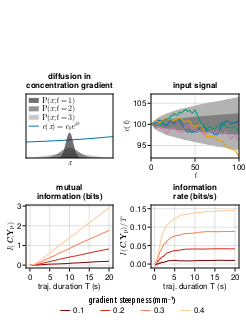

# Figures

This directory contains the code required to reproduce the following figures appearing in the PWS manuscript.

## Gene Expression Results

This figure can be recreated by running the script `figure_gene_expr/figure_gene_expr.jl`.

## Chemotaxis Results

This figure is drawn by `figure_rates/figure_chemotaxis.jl`. The data it is drawn from can be recomputed
with this package, see [figure_rates/README.md](./figure_rates/README.md).
