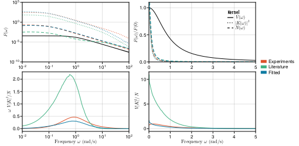

# Noise, response kernel and Gaussian rates of the chemotaxis model

`figure_kernels.jl` compares the Fourier-space kernels of the literature-based and the fitted chemotaxis
model with those of the experiments of Mattingly et al.:



The same data enter the comparison figure in [`../figure_rates/`](../figure_rates/), which shows the
response kernel, the noise autocorrelation and the Gaussian information rate. The figure scripts only plot;
they read these files from `data/` (copies are in `../figure_rates/data/`):

| file | content |
|---|---|
| `cov_data_lit.csv`, `cov_data_fit.csv` | autocovariance of the kinase activity (noise), literature / fitted parameters |
| `kern_data_lit.csv`, `kern_data_fit.csv` | response of the activity to a step in the ligand concentration |
| `../figure_rates/data/gaussian_rates.csv` | coefficient β of the Gaussian information rate `R = β g²` |

The columns of the first four files are the time or lag `t`, the estimate (`Cov` or `Kernel`), the sum of
squared deviations over the trajectories `SqDiff`, the variance of a single trajectory `Var = SqDiff / (Nobs − 1)` and
the number of trajectories `Nobs`. How the committed files were originally made is documented in
[`../figure_rates/PROVENANCE.md`](../figure_rates/PROVENANCE.md). This document explains how to **recompute**
them with the code in this repository.

## What is computed

Both quantities come from stochastic simulations of the full jump process of the receptor clusters and CheY
(Gillespie algorithm; PWS is not involved). The ligand-binding dynamics are integrated out into the activity
probability of a cluster, as in the model of the paper. The kinase activity is inferred from the CheY
phosphorylation state like in experiments, `a(t) = (Yp / Y) · k_Z / (k_A N_c)`.

* **Noise** `N(t)`: at constant ligand concentration (100 µM), simulate 1000 s at a resolution of 0.01 s,
  subtract the mean of the activity and estimate the autocovariance for lags up to 200 s. Average over trajectories.
* **Response kernel** `K(t)`: adapt at 100 µM for 50 s, increase the concentration to 110 µM at `t = 50 s` and
  record the next 200 s at 0.01 s. `K(t) = −⟨a(t) − a(0)⟩ / ln(110/100)`, averaged over trajectories, where
  `a(0)` is the activity of the same trajectory at the step.
* **Parameter sets**: `lit` is the literature-based model (400 clusters with 6 methylation levels), `fit` the
  fitted model (9 clusters with 15 levels), all other parameters as in `PWS.chemotaxis_system`.
* **Gaussian rate**: `β = 1/(4π ln 2) ∫ dω V(ω)|K(ω)|²/N(ω)`, evaluated on the discrete Fourier transforms of
  `K(t)` and the noise autocovariance. For small gradient steepness `g` the information rate is `R = β g²`.

## Recompute

Run the simulations from the repository root with the *package* environment:

```bash
julia --project=. -e 'using Pkg; Pkg.instantiate()'
julia --project=. -t auto figures/figure_kernels/simulate_kernels.jl noise
julia --project=. -t auto figures/figure_kernels/simulate_kernels.jl kernel
julia --project=. figures/figure_kernels/simulate_kernels.jl assemble
julia --project=. figures/figure_kernels/simulate_kernels.jl check
```

The result is written to `data/reproduced/`. `check` compares each recomputed curve with the committed one:
for a few lags it prints both values and their difference in units of the combined standard error, and the root
mean square of that difference over all lags (about 1 if both estimate the same function).

The Fourier transforms and the Gaussian rates are computed from the assembled files with the `figures/`
environment:

```bash
julia --project=figures -e 'using Pkg; Pkg.instantiate()'
julia --project=figures figures/figure_kernels/gaussian_rates.jl --data figures/figure_kernels/data/reproduced
```

This writes `gaussian_rates.csv` next to the data and compares β with the committed values. Without `--data` it
uses the committed `cov_data_*.csv` and `kern_data_*.csv`, which reproduces the committed `gaussian_rates.csv`
exactly (a Lanczos window is applied before the transform, `--window hanning` gives values that differ by
0.15–0.18 %).

To draw the figures from recomputed data, copy the recomputed CSV files over those in `data/` and
`../figure_rates/data/` (the plotting scripts read from there).

### Cost and splitting the work

The defaults are the numbers of the committed data: 10 000 noise trajectories of 1000 s and 100 000 kernel
trajectories of 250 s per parameter set. Measured on 36 cores:

| | per trajectory (CPU s) | defaults, both parameter sets |
|---|---|---|
| noise, literature | 65 | |
| noise, fitted | 76 | 390 CPU hours |
| kernel (both) | 4.7 | 260 CPU hours |

That is about 650 CPU hours, or 18 hours on 36 cores. The trajectories can be split into slices that are computed
independently, for example as the tasks of a job array: `--chunk i/n` computes the i-th of n slices and writes
its own file to `data/reproduced/partial/`. Finished slices are skipped when a command is restarted, and `assemble` checks
that all slices are present. The seed of every trajectory depends only on (command, parameter set, index), so the
result does not depend on the number of threads or slices.

How many trajectories are needed depends on the precision wanted. From the single-trajectory spread stored in the
committed files, a tenth of the defaults still gives a relative standard error of a few percent at the lags that
matter, and 288 noise and 576 kernel trajectories (about 13 CPU hours in total) already agree with the committed curves
(see below), although β of the fitted model is then 7 % off. Use `--ntraj` to change the number.

### Check against the committed data

With 288 noise and 576 kernel trajectories per parameter set, the recomputed curves agree with the committed ones
within the statistical error (root mean square of the difference in standard errors, 1 expected):

| | literature | fitted |
|---|---|---|
| noise autocovariance | 0.99 | 1.13 |
| response kernel | 0.78 | 1.10 |

The Gaussian rate coefficient β computed from these small data sets differs from the committed value by −0.4 %
for the literature model and by +7 % for the fitted model, whose kernel is much noisier at long times. If β of the
fitted model matters, use more kernel trajectories than this test.

### Options

| option | default | meaning |
|---|---|---|
| `--models` | `lit,fit` | parameter sets |
| `--ntraj` | 10000 (`noise`), 100000 (`kernel`) | trajectories per parameter set |
| `--chunk` | `1/1` | `i/n`: compute only the i-th of n slices |
| `--out` | `data/reproduced` | output directory |
