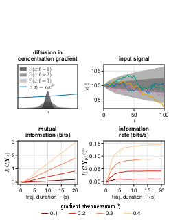

# Chemotaxis figure: mutual information and information rate

`figure_chemotaxis.jl` draws the chemotaxis figure of the PWS manuscript:



* top left: a sketch of diffusion in a concentration gradient,
* top right: a summary of simulated input signals `c(t)` (median bands and sample trajectories),
* bottom left: the mutual information `I(C; Yp)` between the ligand trajectory and the CheY-P
  trajectory as a function of the trajectory duration `T`, for four gradient steepnesses,
* bottom right: the information rate `I/T`.

Only the two lower panels and the input signal depend on simulation data; the sketch is drawn by the script.

The system is the literature chemotaxis model `PWS.chemotaxis_system(n_clusters=400, n=6)`
(400 receptor clusters with 6 methylation levels, `n` is `Lmax` in the paper). Everything else
uses the defaults of `chemotaxis_system`.

The figure script only plots; it reads CSV files from `data/`. The files that were used for the
manuscript are committed, so the published figure can be redrawn at any time (see
[Redraw the published figure](#redraw-the-published-figure)). This document explains how to
**recompute these data files** with the code in this repository. How the published data files were
originally produced (run settings, scripts, aggregation) is documented in [`PROVENANCE.md`](PROVENANCE.md).

| data file | content | produced by |
|---|---|---|
| `data/2023-02-17_mi_trajectories.csv` | mean MI (nats) over N = 14400 trajectories, per gradient `g` and time | `reproduce_chemotaxis.jl compute` + `assemble` |
| `data/input_traj_summary.csv` | quantiles and 20 sample trajectories of `c(t)` for `g = 0.2/mm`, 100 s | `reproduce_chemotaxis.jl input` |

## Recompute the data

All commands are run from the repository root. Computing the data uses the *package*
environment (`--project=.`), plotting uses the `figures/` environment.

```bash
julia --project=. -e 'using Pkg; Pkg.instantiate()'
```

### 1. Mutual information over time

```bash
julia --project=. -t auto figures/figure_rates/reproduce_chemotaxis.jl compute
julia --project=. figures/figure_rates/reproduce_chemotaxis.jl assemble
```

`compute` estimates, for each of the four gradient steepnesses `g = 0.1, 0.2, 0.3, 0.4 mm⁻¹` and
for N = 14400 independent trajectories of 20 s, the trajectory mutual information

    I(t) = ln P(y_{0:t} | c_{0:t}) − ln P(y_{0:t})

on the output time grid (`dt = 0.1 s`) with PWS (`PWS.information_density`). The marginal and the
conditional probability are computed with a particle filter with M = 256 particles, as in the
manuscript. The estimates are averaged over the trajectories. `assemble` writes the average and the
variance of the average to `data/reproduced/mi_trajectories.csv`, in the same columns as the
published file (`Mean` in nats). `Var` here is the variance of the mean of all N trajectories (sample
variance / N). The published `Var` column is defined differently, it is 10 times larger, see
[`PROVENANCE.md`](PROVENANCE.md).

The default algorithm is `PWS.AggregatedSMCEstimate`, a particle filter specialised to the
chemotaxis system that aggregates the likelihood of the CheY-P (de)phosphorylation events
analytically; see `src/ChemotaxisSMC.jl`. It estimates the same quantity as the generic
`PWS.SMCEstimate` used for the manuscript but is much faster. To use the original algorithm, pass
`--algorithm generic`. To see how much the manuscript's M = 256 matters, increase `--particles`.

**Cost.** Measured on 36 cores, 360 trajectories at one gradient take 131 s with the aggregated filter
(including start-up) and 1372 s with the generic one (`--algorithm generic`), which is about 11 times slower. The
aggregated filter needs about 12 CPU seconds per trajectory and gradient, including the simulation of the trajectory
itself. The full figure, 4 × 14400 trajectories, is therefore about 190 CPU hours, or 5 hours on 36 cores.

**Several jobs.** The trajectories can be split into slices that are computed independently,
for example as the tasks of a job array. Every slice writes its own file to `data/reproduced/partial/`,
finished slices are skipped when a command is restarted, and `assemble` checks that all slices are present:

```bash
# in job k of 50
julia --project=. -t auto figures/figure_rates/reproduce_chemotaxis.jl compute --chunk $K/50
# afterwards, once
julia --project=. figures/figure_rates/reproduce_chemotaxis.jl assemble
```

Every trajectory uses a random number stream that depends only on `(g, trajectory index)`, so the
result does not depend on the number of threads or slices.

### 2. Input signal summary

```bash
julia --project=. figures/figure_rates/reproduce_chemotaxis.jl input
```

This integrates the SDE of the input signal for 10 000 trajectories of 100 s and writes
`data/reproduced/input_traj_summary.csv`.

### 3. Compare with the published data

```bash
julia --project=. figures/figure_rates/reproduce_chemotaxis.jl check
```

prints the mutual information at `T = 20 s` of the published and the recomputed data in bits, with
standard errors and the difference in units of the combined standard error. The published standard
error is corrected for how the published `Var` column is defined, see [`PROVENANCE.md`](PROVENANCE.md). A finite particle number
biases the particle-filter estimate of ln P(y) low, so the estimated mutual information is biased
high. This bias decreases with `--particles`, so differences from the published M = 256 data
should be expected to shrink as the particle number is increased.

### Options

All options of `reproduce_chemotaxis.jl` have the parameters of the manuscript as defaults:

| option | default | meaning |
|---|---|---|
| `--clusters` | 400 | receptor clusters |
| `--lmax` | 6 | methylation levels (`n`) |
| `--duration` | 20 | trajectory duration (s) |
| `--dt` | 0.1 | output time step (s) |
| `--gradients` | `1e-4,2e-4,3e-4,4e-4` | gradient steepness `g` (1/µm) |
| `--ntraj` | 14400 | trajectories per gradient |
| `--particles` | 256 | SMC particles per marginalization |
| `--algorithm` | `aggregated` | `aggregated` or `generic` |
| `--chunk` | `1/1` | `i/n`: compute only the i-th of n slices of the trajectories |
| `--input-trajectories` | 10000 | trajectories for the input signal summary |
| `--out` | `data/reproduced` | output directory |

For a quick test of the pipeline use, for example, `--ntraj 72 --out /tmp/chemotaxis-test`.

## Draw the figure

The figure is drawn with the `figures/` environment:

```bash
julia --project=figures -e 'using Pkg; Pkg.instantiate()'

# from the recomputed data (published figure files are left untouched)
CHEMOTAXIS_DATA_DIR=figures/figure_rates/data/reproduced \
CHEMOTAXIS_OUT_DIR=figures/figure_rates/reproduced \
julia --project=figures figures/figure_rates/figure_chemotaxis.jl
```

`CHEMOTAXIS_DATA_DIR` is the directory with the recomputed `mi_trajectories.csv` (if it does not
contain `input_traj_summary.csv`, the published input summary is used). The figure is written to
`CHEMOTAXIS_OUT_DIR` as `chemotaxis.pdf` and `chemotaxis.png`.

### Redraw the published figure

```bash
julia --project=figures figures/figure_rates/figure_chemotaxis.jl
```

reads the committed data in `data/` and writes `chemotaxis.pdf`/`chemotaxis.png` to this directory.
